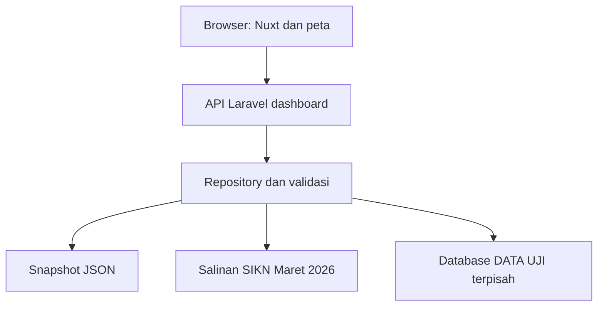
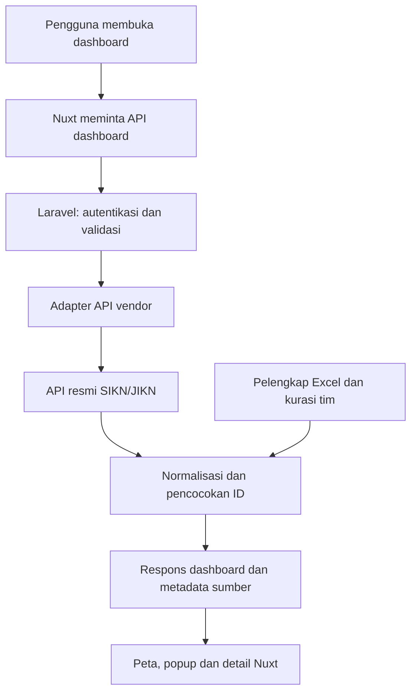

# Catatan integrasi API dan penyatuan dashboard ke SIKN/JIKN

Panduan belajar dan bahan rapat vendor - 26 Oktober 2026

Proyek: Dashboard Monitoring Simpul Jaringan JIKN ANRI. Berdasarkan source lokal Nuxt/Vue dan Laravel. Dokumen ini adalah rancangan kerja, bukan dokumentasi API vendor. Endpoint vendor, autentikasi, alamat produksi, dan metode penyatuan belum disepakati. Tidak ada implementasi API, perubahan source aplikasi, atau deployment yang dilakukan untuk membuat catatan ini.

## Ringkasan untuk dibaca dahulu

**Ada dua pekerjaan berbeda:** menghubungkan data resmi melalui API dan menempatkan dashboard dalam layanan SIKN/JIKN. Keduanya dapat dikerjakan bertahap, tetapi keputusan satu tidak otomatis menyelesaikan yang lain.

Rencana dasarnya: API resmi dibaca oleh **Laravel di server**; Laravel memvalidasi dan menerjemahkan respons menjadi kontrak dashboard; Nuxt tetap memakai kontrak tersebut untuk peta, popup, pencarian, dan detail. Tahun Excel serta hasil kurasi tim digabung berdasarkan identitas yang diverifikasi, tanpa menimpa sembarangan.

Urutan membaca: pahami kondisi sekarang; bedakan integrasi data/tampilan/login; pelajari ID dan pemilik field; gunakan checklist rapat; jalankan PoC kecil; baru lanjutkan staging, pengujian penerimaan dan produksi. Panduan pemrograman umum ada di [panduan flow proyek](/Users/macbookair/dashboard-monitoring-simpul-jaringan-jikn/docs/panduan-flow-dan-pondasi-proyek.md).

Dokumen ini menggunakan tiga label: **sudah ada** untuk perilaku yang tampak pada source, **usulan** untuk desain yang belum dibuat, dan **perlu vendor** untuk keputusan yang tidak dapat ditebak dari database lokal.

<!-- pagebreak -->

## 1. Apa yang sudah kita buktikan sekarang?

Dashboard aktif menggunakan Nuxt 4, Vue 3, TypeScript strict, Leaflet, Laravel 13/PHP dan PostgreSQL. React pada root `src/` masih legacy. Peta aktif berjalan dari `frontend/`, sedangkan API dashboard dari `backend/`.

**Sudah ada:** Nuxt dapat mengambil katalog dari API Laravel; Laravel dapat membaca snapshot JSON, salinan SIKN lokal baca-saja, serta database Development terpisah. Peta, pencarian, popup dan detail memakai repository, sehingga komponen tidak membaca workbook/SQL langsung.



Pilot mempunyai katalog 643 identitas Excel dan 627 pin rujukan publik pada audit sebelumnya. Ini tidak membuktikan semua lokasi lapangan sudah disahkan. Mode SIKN mempertahankan katalog/ID/tahun/pin kurasi lalu menambahkan statistik dan kontak hanya untuk identitas yang cocok. Salinan Maret bukan sumber real-time.

**Belum ada:** koneksi API resmi vendor, login/SSO dengan portal, sinkronisasi produksi, atau deployment ke domain SIKN/JIKN. Berhasil terhubung ke PostgreSQL lokal membuktikan fondasi alur baca, bukan otomatis kompatibilitas API vendor.

Adminer/DBeaver adalah alat memeriksa database. Membuka koneksi pada kedua alat itu tidak menyalakan integrasi API dan bukan syarat browser menampilkan peta. Laravel yang menjadi penghubung data aplikasi.

<!-- pagebreak -->

## 2. Tiga arti "digabung ke SIKN"

| Pekerjaan | Artinya | Keputusan yang dibutuhkan |
| --- | --- | --- |
| Integrasi data | Dashboard membaca identitas/statistik/kontak dari API resmi. | Kontrak API, akses, ID, definisi dan izin data. |
| Integrasi tampilan | Dashboard dapat dibuka melalui menu, domain, atau bagian portal. | Pemilik URL, hosting, reverse proxy, desain dan routing. |
| Integrasi akun | Pengguna memakai identitas/login portal yang sama bila diperlukan. | SSO, role, sesi, logout dan kebijakan akses. |

Sebuah dashboard dapat memakai API resmi tetapi masih mempunyai URL tersendiri. Sebaliknya, dashboard yang muncul dalam menu portal masih bisa memakai snapshot. Karena itu, rapat perlu menetapkan hasil yang dimaksud untuk ketiganya.

**Usulan alur data berikutnya:**



Token layanan vendor tetap di server Laravel. Browser hanya menerima field yang boleh ditampilkan. Akses API untuk akun layanan berbeda dari login manusia: API token tidak otomatis membuat pengguna masuk ke portal, dan halaman Landing Page dapat tetap memerlukan sesi JIKN.

**Kalimat pembuka rapat:** "Kami ingin memastikan integrasi sumber data, penempatan dashboard di portal, dan kebutuhan login bersama. Ketiganya perlu diputuskan terpisah agar implementasinya tepat."

<!-- pagebreak -->

## 3. Bentuk akses API yang perlu diminta

API biasanya dipahami melalui dokumentasi operasi HTTP, aturan autentikasi, parameter dan contoh respons. Format dokumentasi dapat berupa OpenAPI/Swagger, koleksi Postman, atau dokumen vendor. Yang penting ialah isi kontraknya lengkap dan contoh datanya diizinkan.

Minta informasi berikut sebelum menulis adapter:

- Alamat dokumentasi, base URL sandbox/produksi dan versi API.
- Operasi untuk daftar instansi, detail, statistik, kontak, status dan Landing Page.
- Identifier resmi: UUID/string/integer, keunikan, stabilitas dan perilaku saat instansi berganti nama/bergabung.
- Bentuk pagination, batas ukuran halaman, filter wilayah/search, total, dan konsistensi versi data.
- Autentikasi: akun layanan, lingkup baca, masa berlaku/rotasi token dan pembatasan jaringan.
- Contoh respons sukses, field null, statistik nol, record dihapus, dan error.
- Rate limit, timeout/SLA, jadwal perubahan API, kontak dukungan dan hak publikasi.

**Dua API jangan tertukar.** Proyek kita sudah mempunyai endpoint dashboard seperti `GET /api/v1/reference-data`, `GET /api/v1/institutions`, dan `GET /api/v1/institutions/{id}`. Nama tersebut berasal dari `backend/routes/api.php`. Endpoint vendor belum diketahui dan tidak boleh dianggap sama.

Contoh berikut hanya membantu memahami JSON; **bukan struktur respons vendor atau dataset proyek**:

```json
{
  "id": "ID-RESMI-ILUSTRASI",
  "nama": "Instansi Ilustrasi",
  "jumlahArsip": null
}
```

Adapter menentukan bagaimana field vendor diterjemahkan menjadi kontrak internal setelah dokumentasi tersedia. TypeScript pada frontend tidak menggantikan validasi runtime terhadap respons yang datang dari jaringan.

<!-- pagebreak -->

## 4. Bagian kode yang nanti disesuaikan

Nama class baru pada tabel adalah **usulan internal**, bukan komponen yang sudah dibuat.

| Bagian | Tanggung jawab integrasi |
| --- | --- |
| Usulan `VendorApiClient.php` | Request HTTP server ke vendor, autentikasi, timeout dan error aman. |
| Usulan kontrak sumber/DTO vendor | Menyimpan identifier resmi sebagai tipe yang benar. |
| Usulan `VendorRepository.php` | Mengubah respons vendor ke kontrak dashboard dan menggabungkan pelengkap. |
| `DashboardRepository.php` | Memilih sumber vendor secara terpisah dari JSON/SIKN lokal/DATA UJI. |
| `AppServiceProvider.php` | Mendaftarkan adapter vendor tanpa mengganti semua sumber lama secara global. |
| Config backend dan pengelola secret | Base URL, aktivasi sumber, timeout, token dan kebijakan cache. |
| `DashboardRequest.php` dan middleware | Kebijakan akses positif untuk sumber produksi yang baru. |
| Domain/validator backend dan frontend | Field, metadata, ID, null, tanggal dan definisi statistik. |
| `apiRepository.ts`, composable, session/header | Sumber baru, cache, label sumber dan navigasi yang konsisten. |
| `nuxt.config.ts` dan infrastruktur | Alamat API dashboard, routing/base path dan asset saat deployment. |

**Bukan cukup mengganti satu class.** `SiknSource::metrics()` dan `contacts()` saat ini menerima ID database integer. Vendor mungkin menggunakan UUID/string. `DashboardRepository` juga bergantung konfigurasi `.local`, crosswalk, metadata Maret 2026 dan aturan pasangan tertentu. Semua ini perlu dipisahkan atau disesuaikan dengan kontrak vendor.

Mode `sikn`/`dev` memang dibatasi local/testing. Jangan menghapus batas itu agar produksi "bisa jalan". Buat jalur produksi terpisah dengan izin yang jelas; nama mode dan kebijakannya baru ditetapkan pada implementasi.

Laravel menyediakan HTTP client dengan dukungan autentikasi, timeout, penanganan respons dan fasilitas tes. Penggunaannya tetap harus mengikuti kontrak serta batas vendor. [Dokumentasi HTTP client Laravel](https://laravel.com/framework/docs/13.x/http-client).

<!-- pagebreak -->

## 5. ID adalah pondasi pencocokan data

| Identitas | Fungsi | Perlakuan |
| --- | --- | --- |
| ID lokal dashboard | Menjaga tautan detail dan identitas record yang sudah ada. | Pertahankan; jangan dibentuk ulang setiap nama berubah. |
| Kode Excel | Referensi pada pengelolaan casefile. | Simpan sebagai teks; bukan kunci tunggal karena ada duplikasi. |
| ID/UUID vendor | Identitas resmi menurut sistem sumber. | Ikuti kontrak; jangan dipaksa integer jika sebenarnya UUID. |

**Usulan crosswalk:** simpan hubungan `localId` dengan identifier vendor, sistem sumber, status verifikasi, alasan/bukti pencocokan dan waktu review. Simpan versi/histori agar koreksi dapat ditelusuri. Nama instansi membantu review tetapi tidak cukup menjadi kunci permanen.

Aturan sederhana: satu pasangan resmi yang unik boleh dipakai; hasil ambigu ditinjau manual; hasil belum cocok tetap tercatat dengan nilai yang belum tersedia. Jangan menggabungkan dua instansi berbeda hanya karena kode atau namanya mirip.

Contoh latihan sintetis: satu ID lokal "latihan-01" dipasangkan ke identifier vendor "vendor-latihan-A". Jika nama tampilannya berubah, identitas tetap sama selama pasangan resmi masih benar. Jika vendor menonaktifkan atau menggabungkan entitas, proses review perlu menentukan histori dan pengalihan, bukan menghapus record secara diam-diam.

Crosswalk lokal sekarang sudah membantu pembuktian alur. Namun ia masih berbasis salinan database dan belum menjadi layanan pemetaan identitas produksi. Kepemilikan serta cara review/edit crosswalk perlu ditetapkan kepada tim yang berwenang.

**Yang perlu ditanyakan:** "Identifier mana yang stabil untuk setiap instansi, dan apakah UUID pada Landing Page sama dengan identifier yang tersedia di API? Bagaimana kami mengetahui record dihapus, digabung atau diganti?"

<!-- pagebreak -->

## 6. Siapa pemilik setiap field?

Ketersediaan API tidak berarti semua data lokal harus ditimpa. Sepakati sumber utama per field dan aturan saat ada konflik.

| Field | Usulan sumber utama | Jika belum tersedia atau bertentangan |
| --- | --- | --- |
| Nama/ID/status resmi | Vendor setelah identitas terverifikasi. | Tampilkan status review; jangan membuat identitas baru sembarangan. |
| Tahun bergabung | Excel/pelengkap terverifikasi sampai vendor menyediakan field yang disepakati. | Null; bukan `created_at` atau tahun saat ini. |
| Koordinat/alamat kantor | Hasil pengumpulan tim yang sudah diperiksa. | Pertahankan bukti dan sumber; review konflik dengan vendor. |
| Email/telepon | Kontak instansi yang diizinkan dari sumber resmi. | Saring placeholder/ambigu; jangan mengambil kontak akun pengguna/PIC otomatis. |
| Statistik | API vendor menurut definisi yang disepakati. | Null jika tidak diketahui; angka nol sah tetap 0. |
| Landing Page | URL resmi atau UUID dengan aturan URL yang dikonfirmasi vendor. | Tombol nonaktif sampai kepemilikan/ketersediaan dapat dipastikan. |
| Metadata dan ID lokal | Dashboard/pengelola integrasi. | Simpan sumber, versi, waktu data dan status verifikasi. |

Tahun dari Excel, statistik dari API, dan koordinat tim boleh tampil dalam satu profil selama sumber masing-masing jelas. Hindari satu label "terbaru" yang membuat semua field seolah diperbarui bersamaan.

Simpan nilai asli dari sumber untuk pemeriksaan bila diizinkan, pisahkan normalisasi dari publikasi, dan jangan menaruh data internal yang tidak dibutuhkan ke JSON publik. Informasi kosong, salah format, dan belum disetujui adalah tiga kondisi berbeda; UI perlu menjelaskannya dengan bahasa sederhana.

**Pertanyaan statistik:** apakah yang dihitung deskripsi, berkas, lembar, koleksi, atau arsip terpublikasi? Apakah entitas terkait benar pencipta? Apakah metadata digital menjamin file dapat diakses? Definisi salinan lokal sekarang belum otomatis menjawabnya.

<!-- pagebreak -->

## 7. Data terbaru, cache, dan sinkronisasi

**API bukan jaminan real-time.** Ada waktu perubahan pada SIKN, waktu API memperlihatkannya, waktu Laravel mengambilnya, dan waktu browser memperbarui tampilan. Sebagai ilustrasi, pembaruan lima menit sekali dapat membuat pengguna melihat data beberapa menit lebih lama; angka ini bukan jadwal yang telah disepakati.

| Pola | Kelebihan | Hal yang perlu disiapkan |
| --- | --- | --- |
| Request langsung melalui Laravel | Alur awal sederhana dan mengikuti respons sumber. | Ketergantungan latency, rate limit, timeout dan biaya request. |
| Cache/staging berkala | Tampilan lebih stabil; kurangi request berulang. | TTL, sumber/waktu, invalidasi, status gagal dan konsistensi versi. |
| Notifikasi perubahan/webhook | Dapat mempercepat pembaruan jika vendor menyediakan. | Kontrak resmi, verifikasi pengirim, antrean, idempotensi dan pemulihan event. |

Untuk PoC, usulkan pembacaan terbatas lalu ukur. Untuk produksi, pilih pola bersama vendor dan pengelola infrastruktur. Katalog sekarang dibaca penuh oleh repository dan frontend menggabungkan pagination. Jangan menerapkan pola itu ke volume vendor yang jauh lebih besar tanpa pengukuran atau desain staging/query yang sesuai.

**Usulan aturan pemulihan:** ketika pembaruan gagal setelah data pernah berhasil diambil, pertahankan data terakhir yang masih diizinkan oleh aturan akses, tandai sebagai basi, dan tampilkan waktu sumber. Jika hak akses dicabut atau respons 401/403, jangan terus menampilkan data privat dari cache tanpa dasar izin.

Cache harus dibedakan menurut versi sumber, filter dan hak akses. Metadata perlu membedakan `sourceUpdatedAt` atau waktu rujukan vendor dari waktu terakhir berhasil diambil. Data simulasi tidak boleh dijadikan fallback diam-diam untuk data resmi.

<!-- pagebreak -->

## 8. Autentikasi, izin, dan error

Pisahkan akun layanan Laravel ke API vendor dari akun manusia yang membuka dashboard. API publik tertentu mungkin tidak memerlukan login pengguna; fungsi pengelolaan tetap memerlukan autentikasi/otorisasi yang ditetapkan. Kebutuhan SSO mengikuti kebijakan portal, bukan asumsi dari kepemilikan token API.

Token/vendor secret berada di backend atau pengelola secret server. Jangan menaruhnya di `runtimeConfig.public`, source frontend, URL, Git, screenshot, atau log. Gunakan HTTPS dan ruang lingkup baca minimum. Konfigurasi produksi harus menyatakan siapa yang boleh membaca field publik, terbatas, atau data pengelolaan.

| Kejadian | Perilaku yang direncanakan |
| --- | --- |
| 401 | Periksa/segarkan akses sesuai kontrak; jangan mencetak token atau mencoba terus tanpa batas. |
| 403 | Hentikan akses yang dilarang dan tampilkan pesan sesuai hak pengguna. |
| 404 | Bedakan record tidak ada, tidak dipublikasikan, dan mapping tidak cocok jika kontrak memungkinkan. |
| 429 | Hormati batas vendor dan `Retry-After` bila tersedia; antrekan atau tunda request. |
| 5xx/timeout | Retry terbatas untuk operasi aman; tampilkan status gagal/basi yang jujur. |
| Payload berubah/tidak valid | Tolak field yang tidak sesuai, catat diagnostik aman, jangan menampilkan angka tebakan. |

Request baca dapat diberi retry terbatas sesuai kontrak. Penulisan tidak boleh diulang sembarangan; perlukan aturan idempotensi atau rekonsiliasi. Integrasi awal yang diusulkan adalah baca saja, bukan membuat/mengubah instansi pada SIKN.

Log teknis cukup memuat jenis operasi, status, durasi, correlation ID dan sumber; hindari isi arsip, kontak personal atau seluruh payload. SSO, session cookie, CSRF, logout bersama, masa sesi serta role perlu review khusus jika dashboard berbagi akun dengan portal.

<!-- pagebreak -->

## 9. Cara menempatkan dashboard pada portal

Belum ada keputusan tentang bentuk hosting dan stack portal vendor. Pilihan berikut merupakan bahan diskusi, bukan domain/konfigurasi yang sudah dibuat.

| Pilihan | Cocok ketika | Konsekuensi |
| --- | --- | --- |
| Layanan terpisah ditautkan dari menu portal | Ingin integrasi bertahap dan pengelolaan rilis terpisah. | Samakan identitas visual; putuskan domain, navigasi dan kebutuhan SSO. |
| Layanan Nuxt di subpath portal melalui reverse proxy | Ingin alamat tetap berada dalam portal. | Atur prefix, base URL, asset, deep link, SSR dan routing API; uji bentrokan path. |
| Memindahkan komponen ke codebase portal | Portal memakai stack/versi yang kompatibel dan vendor menyetujui. | Audit dependensi, CSS, routing, data serta ownership; komponen tidak otomatis dapat dipindah tanpa adaptasi. |
| Iframe | Hanya jika disepakati dan dapat memenuhi kebutuhan UX/akses. | Perlu pemeriksaan frame policy, cookie/login, aksesibilitas, ukuran, navigasi dan keamanan. |

**Usulan awal:** integrasikan data dan jalankan sebagai layanan staging terpisah dahulu; setelah benar, sepakati penempatan URL/menu. Cara ini memisahkan pembuktian data dari risiko perubahan portal yang sudah digunakan masyarakat. Tetap ikuti keputusan infrastruktur/vendor.

Nuxt mendukung deployment Node dan pengaturan base path; metode deployment lain perlu dinilai sesuai kebutuhan aplikasi/server routes. Dokumentasi resmi menjelaskan entrypoint build serta konfigurasi subpath. Ini bukan izin menyalin konfigurasi contoh ke server produksi tanpa review. [Deployment Nuxt](https://github.com/nuxt/nuxt/blob/main/docs/1.getting-started/16.deployment.md).

Menggunakan bahasa PHP di kedua backend tidak otomatis membuat proyek dapat digabung file demi file. Menggunakan Vue di kedua tampilan juga tidak menjamin router, versi Nuxt atau dependensinya sama. Rapat harus memastikan stack dan pembagian tanggung jawab vendor.

<!-- pagebreak -->

## 10. Jaringan lokal tidak sama dengan produksi

Sekarang browser dapat membaca API dashboard pada `http://127.0.0.1:8000/api/v1`. Di laptop pengguna lain, `127.0.0.1` menunjuk laptop mereka sendiri. Alamat ini tidak boleh tertinggal sebagai alamat API publik setelah deployment.

Nuxt melakukan sebagian fetch saat SSR di server dan sebagian di browser. Kedua jalur harus mencapai layanan yang benar. Pilih rancangan same-origin dengan reverse proxy/server route, atau endpoint publik dengan origin yang diizinkan secara spesifik. URL browser dan alamat jaringan internal server mungkin perlu dibedakan.

**CORS bukan autentikasi.** CORS mengatur akses lintas origin oleh browser. Request Laravel ke vendor tidak memerlukan izin CORS browser, tetapi tetap memerlukan autentikasi dan jaringan yang benar. Jika browser memanggil Laravel beda origin, konfigurasi CORS Laravel harus sesuai. Login/cookie lintas origin memerlukan rancangan tambahan; jangan hanya mengubahnya menjadi wildcard.

Hal yang perlu diuji pada staging:

- Halaman awal, refresh langsung pada detail, asset CSS/JS dan tile peta.
- Navigasi internal, tombol kembali, pencarian dan query mode di bawah prefix URL.
- URL API dari SSR maupun browser, HTTPS, proxy headers dan pembatasan akses.
- Tidak ada token, file `.local`, workbook, handoff atau database yang disajikan sebagai asset publik.
- `APP_ENV` produksi, error debug nonaktif, dan mode pengujian tidak terbuka ke publik.

Jangan memakai `?data=sikn` lokal sebagai jalan pintas produksi: gate lokal memang menolaknya. Proxy DATA UJI juga dev-only. Adapter produksi membutuhkan izin akses tersendiri, bukan melemahkan isolasi yang sudah ada.

<!-- pagebreak -->

## 11. Tahapan implementasi yang dapat diikuti

| Tahap | Pekerjaan | Bukti selesai |
| --- | --- | --- |
| 0. Kesepakatan | Kontrak, sandbox, izin data, ID, penempatan dan penanggung jawab. | Dokumen keputusan dan contoh respons resmi yang diizinkan. |
| 1. PoC kecil | Baca satu sampai lima instansi melalui Laravel. Tidak menulis ke vendor. | Nilai sama dengan sumber vendor; token tidak sampai browser. |
| 2. Normalisasi | Pemetaan ID, tahun Excel, koordinat tim, statistik/kontak dan metadata. | Kasus cocok/ambigu/null/0 ditangani; ID lokal tidak berubah. |
| 3. Ketahanan | Pagination, cache, timeout, error, rate limit dan perubahan schema. | Tes otomatis kontrak dan kegagalan; tidak mengganti data dengan simulasi. |
| 4. Staging | Pasang pada URL uji dengan rancangan jaringan/akses yang disepakati. | Peta, popup, filter, detail, Landing Page dan navigasi bekerja. |
| 5. Penerimaan | Vendor, mentor/pengelola data dan tim menguji hasil bersama. | Daftar koreksi serta persetujuan sesuai tanggung jawab. |
| 6. Produksi bertahap | Aktivasi terkontrol, monitoring, backup dan rencana pemulihan. | Prosedur operasi dan rollback siap; akses pengelolaan dibatasi. |

Perbaiki bug relevan dari [audit 24 Oktober](/Users/macbookair/dashboard-monitoring-simpul-jaringan-jikn/docs/audit-proyek-2026-10-24.md), terutama kegagalan refresh, konflik URL, status verifikasi dan fokus keyboard, sebelum menganggap staging sebagai hasil akhir. Tinjau pula peringatan dependency yang sudah dicatat. Dokumen ini tidak mengklaim perbaikannya telah dilakukan.

Estimasi waktu baru masuk akal setelah kontrak, akses sandbox, contoh payload dan cara deployment jelas. Jangan menjanjikan semua selesai hanya karena satu request API berhasil.

<!-- pagebreak -->

## 12. Checklist pengujian dan rencana pemulihan

### Kontrak dan data

- [ ] Identitas resmi string/UUID tidak rusak karena cast ke integer.
- [ ] Kode Excel duplikat tidak menggabungkan instansi berbeda.
- [ ] Tahun Excel, koordinat tim dan kontak/statistik vendor mempunyai sumber masing-masing.
- [ ] Null tetap "Belum tersedia"; nol sah tetap 0.
- [ ] Pagination tidak menghilangkan atau menggandakan record; versi snapshot konsisten.
- [ ] Perubahan nama, penonaktifan dan record belum cocok mempunyai prosedur review.
- [ ] Landing Page hanya aktif untuk instansi yang benar; status verifikasi dibatalkan jika bukti berubah.

### Aplikasi dan akses

- [ ] Nasional sampai instansi, pencarian, cluster/spiderfy, hover, anchor, detail dan kembali bekerja.
- [ ] Record tanpa koordinat dapat ditemukan; tidak dibuat titik kantor perkiraan.
- [ ] Desktop, mobile390px, keyboard, zoom browser serta browser tim sudah diuji.
- [ ] 401/403/404/429/5xx, timeout, jaringan putus dan payload salah diuji.
- [ ] Token/field terbatas tidak muncul di browser, log atau artifact publik.
- [ ] Refresh halaman detail/subpath bekerja dari SSR maupun browser.

**Rencana pemulihan:** gunakan feature flag sumber; jika terjadi masalah, hentikan pengambilan sumber baru tanpa menghapus hasil kurasi atau crosswalk. Pengguna harus mengetahui sumber/status yang sedang ditampilkan. Fallback ke snapshot yang sudah diizinkan memerlukan label dan aturan eksplisit; bukan mengganti angka API dengan simulasi diam-diam. Rollback deployment tidak otomatis mengembalikan perubahan database, sehingga migrasi dan backup harus mempunyai prosedur terpisah.

Checklist ini adalah rencana pengujian integrasi mendatang. Hasil audit lama bukan bukti API vendor telah lulus tes tersebut. Tidak ada tes integrasi vendor yang dijalankan untuk membuat catatan ini.

<!-- pagebreak -->

## 13. Lembar rapat vendor yang dapat langsung digunakan

**Tujuan:** menyepakati sumber data, identitas, akses, penempatan dashboard dan kriteria penerimaan.

1. Apa alamat dokumentasi dan sandbox API? Siapa PIC teknis dan pemilik datanya?
2. Operasi mana yang disediakan untuk instansi, detail, statistik, kontak dan tautan?
3. ID resmi mana yang stabil? Apakah UUID halaman JIKN sama dengan ID API?
4. Apakah ada tahun bergabung? Jika belum, apakah pelengkap Excel boleh tetap digabung?
5. Apakah koordinat/alamat dan Landing Page dari tim boleh menjadi data koreksi? Siapa yang menyetujui konflik?
6. Apa definisi dan status publikasi setiap statistik? Apa beda record aktif dengan anggota terverifikasi?
7. Kontak/field apa yang boleh tampil ke masyarakat, pengguna login dan pengelola?
8. Bagaimana autentikasi akun layanan, lingkup akses, rotasi dan pembatasan jaringan?
9. Bagaimana pagination, batas request, SLA, polling atau webhook dan perubahan versi API?
10. Dashboard ditempatkan sebagai layanan terpisah, subpath, atau komponen portal? Stack/versi portal apa?
11. Apakah butuh login/SSO bersama? Bagaimana role, sesi, logout dan audit pengguna?
12. Siapa menyiapkan server/proxy/domain/HTTPS, memelihara aplikasi, menguji dan menyetujui rilis?

### Catatan keputusan

- Bentuk integrasi data yang disepakati: ........................................
- URL/penempatan dashboard: .....................................................
- Model login dan pihak yang boleh mengakses: ...................................
- Sumber utama setiap field dan peninjau konflik: ................................
- Dokumen/contoh yang akan diberikan vendor: ....................................
- PIC, tindak lanjut dan target review: .........................................
- Hal yang masih belum diputuskan: ..............................................

Jangan menuliskan password, token atau cookie pada lembar rapat yang dibagikan. Minta akses melalui saluran resmi yang ditetapkan pengelola.

<!-- pagebreak -->

## 14. Belajar dengan satu contoh perjalanan data

Bayangkan pengguna membuka satu instansi. Nuxt mengirim ID lokal ke API dashboard. Laravel mencari pasangan identifier vendor yang sudah diverifikasi, meminta data yang diizinkan, memvalidasinya, lalu menggabungkan tahun dari Excel serta koordinat tim menurut aturan pemilik field. Laravel mengembalikan kontrak instansi dan metadata. Nuxt menampilkan popup/detail dengan label sumber dan nilai yang benar.

Jika vendor tidak mengenali identifier, sistem menandainya untuk review; ia tidak mencari nama yang mirip lalu mengambil statistik milik instansi lain. Jika API gagal, sistem menjelaskan kegagalan atau memakai data terakhir sesuai aturan izin. Jika Landing Page belum dapat dipastikan, tombol tetap nonaktif. Semua ini merupakan perilaku yang harus dibuktikan lewat tes.

### Latihan pemahaman

1. Jelaskan perbedaan endpoint dashboard dengan endpoint vendor.
2. Mengapa token layanan tidak diletakkan pada Nuxt public config?
3. Mengapa UUID vendor tidak selalu dapat dipakai sebagai integer repository ID?
4. Field mana milik Excel, tim kurasi, vendor dan dashboard?
5. Mengapa membuka dashboard dari menu portal belum berarti sudah ada SSO?
6. Jika API berubah, bagian mana yang sebaiknya disesuaikan dahulu?

### Glosarium

| Istilah | Arti sederhana |
| --- | --- |
| Kontrak API | Kesepakatan operasi, input, output, akses dan error. |
| Adapter | Penerjemah data sumber menjadi bentuk yang dipahami dashboard. |
| Crosswalk | Pemetaan identitas antarsistem dengan bukti verifikasi. |
| SSR | Halaman/data awal diproses oleh server Nuxt sebelum interaksi browser. |
| Reverse proxy | Pintu server yang meneruskan request ke layanan yang tepat. |
| CORS | Aturan browser untuk akses lintas origin; bukan pengganti autentikasi. |
| SSO | Mekanisme memakai identitas/login bersama yang disepakati. |
| Staging | Lingkungan uji sebelum produksi. |
| TTL/idempoten | Masa cache berlaku / pengulangan tidak menggandakan efek. |

<!-- pagebreak -->

## 15. Referensi dan pegangan source

### File proyek yang menjadi dasar

- [Kontrak repository backend](/Users/macbookair/dashboard-monitoring-simpul-jaringan-jikn/backend/app/Repositories/InstansiRepository.php) dan [pemilih adapter](/Users/macbookair/dashboard-monitoring-simpul-jaringan-jikn/backend/app/Repositories/DashboardRepository.php).
- [Kontrak sumber SIKN lokal](/Users/macbookair/dashboard-monitoring-simpul-jaringan-jikn/backend/app/Services/SiknSource.php), [pembaca PostgreSQL](/Users/macbookair/dashboard-monitoring-simpul-jaringan-jikn/backend/app/Services/PostgresSiknSource.php), dan [binding Laravel](/Users/macbookair/dashboard-monitoring-simpul-jaringan-jikn/backend/app/Providers/AppServiceProvider.php).
- [Endpoint dashboard](/Users/macbookair/dashboard-monitoring-simpul-jaringan-jikn/backend/routes/api.php), [validasi mode](/Users/macbookair/dashboard-monitoring-simpul-jaringan-jikn/backend/app/Http/Requests/DashboardRequest.php), dan [CORS](/Users/macbookair/dashboard-monitoring-simpul-jaringan-jikn/backend/config/cors.php).
- [Repository HTTP frontend](/Users/macbookair/dashboard-monitoring-simpul-jaringan-jikn/frontend/app/services/apiRepository.ts), [pemilihan mode](/Users/macbookair/dashboard-monitoring-simpul-jaringan-jikn/frontend/app/composables/useInstansiRepository.ts), dan [konfigurasi Nuxt](/Users/macbookair/dashboard-monitoring-simpul-jaringan-jikn/frontend/nuxt.config.ts).
- [Panduan flow proyek](/Users/macbookair/dashboard-monitoring-simpul-jaringan-jikn/docs/panduan-flow-dan-pondasi-proyek.md), [audit 24 Oktober](/Users/macbookair/dashboard-monitoring-simpul-jaringan-jikn/docs/audit-proyek-2026-10-24.md), [uji SIKN lokal](/Users/macbookair/dashboard-monitoring-simpul-jaringan-jikn/docs/uji-database-sikn-lokal.md), dan [aturan kontak](/Users/macbookair/dashboard-monitoring-simpul-jaringan-jikn/docs/kontak-instansi.md).

### Referensi resmi teknis

- [HTTP client Laravel13](https://laravel.com/framework/docs/13.x/http-client): fasilitas request keluar, autentikasi, timeout, retry dan pengujian. Rencana adapter perlu merujuk kontrak vendor, bukan menyalin endpoint contoh dokumentasi.
- [Deployment Nuxt - source dokumentasi resmi](https://github.com/nuxt/nuxt/blob/main/docs/1.getting-started/16.deployment.md): pilihan runtime/deployment serta pengaturan base path. Konfigurasi server portal tetap memerlukan keputusan pengelola.

Source proyek diperiksa pada 26 Oktober 2026. Catatan audit/data yang dirujuk mempunyai tanggalnya sendiri. Tidak membaca kredensial atau workbook/database privat untuk menyusun dokumen ini, tidak mengubah source aplikasi, dan tidak melakukan commit, push, merge atau deployment. Isi rapat dan kontrak vendor nantinya harus menggantikan bagian yang masih berupa usulan.
