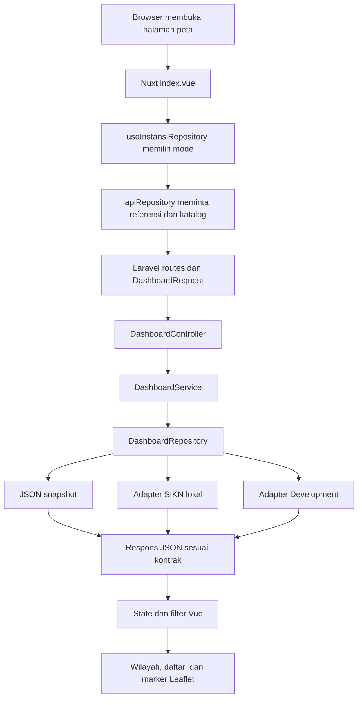
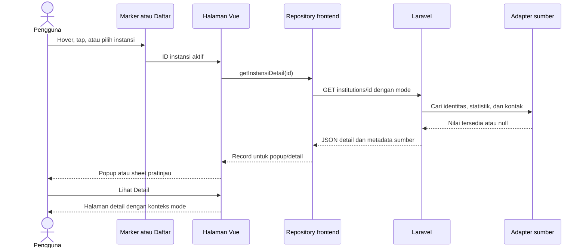
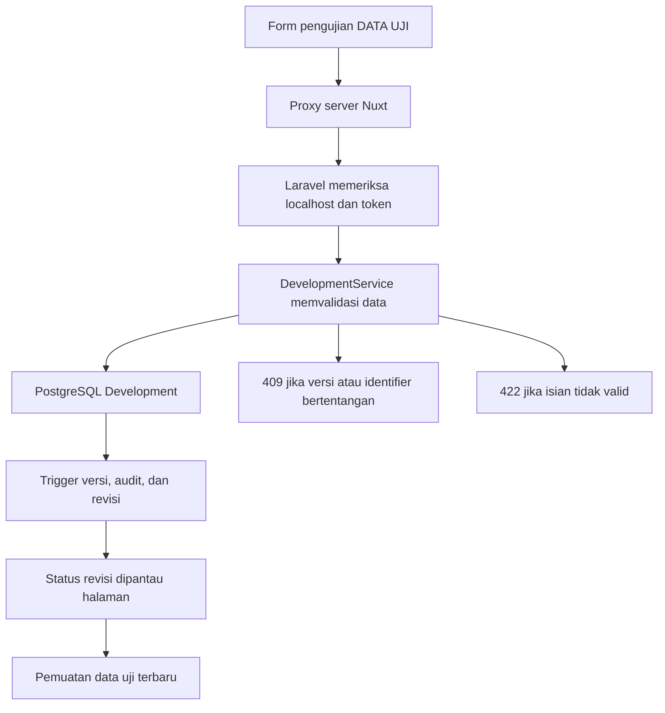

# Panduan belajar: flow dan pondasi Dashboard Monitoring Simpul Jaringan JIKN

Ditinjau dari source code lokal pada **24 Oktober 2026**. Panduan ini menjelaskan aplikasi yang sedang dikembangkan, bukan dokumentasi API resmi vendor. Hasil pemeriksaan bug dan pengujian dicatat terpisah dalam [laporan audit proyek](/Users/macbookair/dashboard-monitoring-simpul-jaringan-jikn/docs/audit-proyek-2026-10-24.md). Panduan ini tidak menyatakan seluruh bug sudah diperbaiki.

## 1. Mulai dari gambaran besarnya

Dashboard menghubungkan katalog instansi dengan wilayah Indonesia. Pengguna dapat memilih provinsi, masuk ke kabupaten/kota, melihat instansi, membuka popup, kemudian membaca halaman detail. Pencarian dan Daftar menyediakan jalur lain, termasuk untuk instansi yang belum mempunyai koordinat.

Aplikasi aktif sekarang terdiri dari **frontend Nuxt/Vue**, **backend Laravel/PHP**, serta beberapa sumber data. Browser menangani tampilan dan interaksi. Laravel memeriksa permintaan, membaca sumber yang sesuai, lalu mengirim JSON. Sumbernya dapat berupa snapshot JSON, salinan database SIKN, atau database pengujian yang terpisah.

Pemisahan tersebut memungkinkan tampilan mempertahankan kontrak data yang sama ketika sumber berubah. Integrasi API vendor tetap membutuhkan pekerjaan pemetaan, autentikasi, pengujian, dan kesepakatan definisi statistik; tidak cukup mengganti satu alamat URL.

**Perhatikan folder kerja.** Implementasi aktif berada di `frontend/` dan `backend/`. Folder `src/`, konfigurasi Vite, dan perintah npm di root mempertahankan **React lama** sebagai pembanding. Menjalankan server Vite root bukan menjalankan Nuxt. Sebagian README dan dokumentasi migrasi masih berisi instruksi atau angka historis; cocokkan dengan bagian aktif panduan ini dan [laporan audit](/Users/macbookair/dashboard-monitoring-simpul-jaringan-jikn/docs/audit-proyek-2026-10-24.md).

## 2. Teknologi dan perannya

| Teknologi | Peran dalam proyek |
| --- | --- |
| Nuxt 4 | Kerangka aplikasi frontend: routing berdasarkan file, pemuatan data, konfigurasi, dan server Nuxt. |
| Vue 3 | Komponen tampilan yang bereaksi terhadap perubahan state. |
| TypeScript strict | Kontrak bentuk data dan pemeriksaan kesalahan tipe sebelum aplikasi dijalankan. |
| Leaflet | Menggambar tile, polygon, marker, popup, serta mengelola viewport peta. |
| Leaflet.markercluster | Mengelompokkan marker berdekatan dan mengurai marker bertumpuk. |
| Laravel 13 dan PHP | API dashboard, validasi, pemilihan adapter, serta akses data. |
| PostgreSQL | Penyimpanan database SIKN lokal dan database Development yang terpisah. |
| Adminer | Antarmuka browser untuk memeriksa tabel dan data PostgreSQL. |
| JSON dan GeoJSON | Format pertukaran snapshot, metadata, serta geometri wilayah. |
| Vitest, PHPUnit, Playwright | Pengujian fungsi, backend, dan interaksi browser. |

Versi pada konfigurasi frontend adalah Nuxt **4.6.2**, Vue **3.5.44**, TypeScript **~5.9.3**, Leaflet **1.9.4**, serta markercluster **1.5.3**. Backend mensyaratkan PHP **^8.4** dan Laravel **^13.17**. Versi PHP yang dipakai proses server perlu diperiksa terpisah dari PHP terminal. Lockfile membantu anggota tim memasang dependensi yang konsisten.

File `.vue` umumnya mempunyai `<script setup>` untuk logika, `<template>` untuk tampilan, dan kadang `<style>` untuk gaya. `ref` menyimpan nilai reaktif; `computed` menghitung nilai turunan; `watch` menjalankan reaksi tertentu. Perubahan state tidak otomatis berarti database ikut berubah: penulisan tetap membutuhkan permintaan ke backend.

## 3. Lima mode yang harus dibedakan

Jumlah berikut dihitung dari JSON runtime saat panduan disusun. Cakupan katalog bukan jaminan semua kantor atau kontak telah disahkan ANRI.

| Mode dan URL | Sumber serta cakupan |
| --- | --- |
| Pilot: `/simpul-jaringan` | **643 instansi, 627 pin, 16 tanpa pin**, 38 provinsi, 514 kabupaten/kota. Semua 643 tahun bergabung tersedia dari Excel. Statistik dan grafik tetap **DATA SIMULASI**. |
| Excel: `?data=excel` | **643 instansi, 643 tahun**, tanpa pin dan statistik simulasi. Snapshot sumber dipisahkan dari pengayaan pilot. |
| Demo: `?demo=1` | **7 instansi sintetis, 6 pin**, dengan kasus koordinat identik, angka nol, dan nilai null untuk pengujian. Lima record mempunyai tahun; dua lainnya null. |
| SIKN lokal: `?data=sikn` | Katalog, ID, tahun, dan pin pilot dipertahankan; statistik serta kontak detail dibaca dari **salinan database Maret 2026** apabila identitas cocok. Bukan API vendor atau data real-time. |
| Development: `?data=dev` | Data **DATA UJI** dalam PostgreSQL terpisah. Jumlah berubah mengikuti pengujian formulir. Tidak merupakan tambahan instansi resmi. |

Mode SIKN tidak otomatis menampilkan seluruh baris database sebagai instansi baru. Adapter menghubungkan katalog lokal dengan identitas database melalui pemetaan yang diperiksa. Record yang belum cocok tetap ditemukan, tetapi statistik atau kontaknya belum tersedia. Tahun Excel tidak diganti dengan tanggal pembuatan record database.

Dokumentasi nasional memuat [cakupan dan pengecualian koordinat](/Users/macbookair/dashboard-monitoring-simpul-jaringan-jikn/docs/pilot-indonesia.md). Saat ini hanya **satu Landing Page pilot yang berstatus terverifikasi**, yaitu ANRI; tombol lain tidak boleh diisi URL hasil tebakan.

## 4. Peta folder dan urutan membaca file

| Lokasi | Yang dipelajari |
| --- | --- |
| [frontend/nuxt.config.ts](/Users/macbookair/dashboard-monitoring-simpul-jaringan-jikn/frontend/nuxt.config.ts) | Konfigurasi API, tile, CSS, strict mode, dan pemisahan konfigurasi privat/publik. |
| [frontend/app/app.vue](/Users/macbookair/dashboard-monitoring-simpul-jaringan-jikn/frontend/app/app.vue) | Header bersama dan pemilihan halaman. Pergantian mode/path membentuk konteks halaman baru. |
| [halaman peta](/Users/macbookair/dashboard-monitoring-simpul-jaringan-jikn/frontend/app/pages/simpul-jaringan/index.vue) | Pemuatan katalog, filter, state wilayah, pencarian, popup, dan navigasi detail. |
| [halaman detail](/Users/macbookair/dashboard-monitoring-simpul-jaringan-jikn/frontend/app/pages/simpul-jaringan/[id].vue) | Pembacaan satu instansi dan penyajian statistik beserta sumber. |
| [halaman pengujian](/Users/macbookair/dashboard-monitoring-simpul-jaringan-jikn/frontend/app/pages/pengujian.vue) | Form tambah/edit, koordinat manual, kontak, dan simulasi sinkronisasi. |
| [useInstansiRepository](/Users/macbookair/dashboard-monitoring-simpul-jaringan-jikn/frontend/app/composables/useInstansiRepository.ts) | Mengubah query mode menjadi pilihan repository. |
| [apiRepository](/Users/macbookair/dashboard-monitoring-simpul-jaringan-jikn/frontend/app/services/apiRepository.ts) | Permintaan HTTP, pagination, cache, serta penanganan kegagalan. |
| [domain.ts](/Users/macbookair/dashboard-monitoring-simpul-jaringan-jikn/frontend/app/types/domain.ts) | Definisi Instansi, Wilayah, Metric, metadata, dan kontrak repository. |
| [exploration.ts](/Users/macbookair/dashboard-monitoring-simpul-jaringan-jikn/frontend/app/services/exploration.ts) | Aturan provinsi → kabupaten/kota → instansi dan pemrosesan query/filter. |
| [MapView.client.vue](/Users/macbookair/dashboard-monitoring-simpul-jaringan-jikn/frontend/app/components/map/MapView.client.vue) | Lifecycle Leaflet, polygon, markercluster, popup, dan cleanup. |
| `frontend/app/components/instansi/` | Isi popup, profil, logo/placeholder, dan kartu statistik. |
| `frontend/app/components/charts/` | Grafik Vue dan alternatif pembacaan datanya. |
| `frontend/app/assets/css/` | Warna, ukuran, layout, gaya peta, dan detail. |
| [backend/routes/api.php](/Users/macbookair/dashboard-monitoring-simpul-jaringan-jikn/backend/routes/api.php) | Pintu masuk endpoint Laravel milik dashboard. |
| `backend/app/Http/Requests/` dan `Controllers/` | Validasi permintaan dan pembentukan respons HTTP. |
| `backend/app/Services/` | Logika filter, detail, kontak, query SIKN, dan pengujian. |
| `backend/app/Repositories/` | Kontrak data dan adapter JSON, SIKN, atau Development. |
| `public/data/` dan `public/demo/` | Snapshot bersama, referensi, serta geometri yang digunakan adapter JSON. |
| `data/curation/` dan `scripts/` | Kurasi serta proses impor/pembuatan snapshot; bukan pembacaan Excel oleh browser. |
| `frontend/tests/` dan `backend/tests/` | Tes aplikasi aktif; root `tests/` juga menyimpan tes legacy/data. |
| `.local/` | Konfigurasi, database, atau bukti QA privat lokal; tidak untuk dibagikan melalui Git. |

Folder `.nuxt/` dan `.output/` dihasilkan Nuxt; `node_modules/` serta `backend/vendor/` berisi dependensi. Jangan memperbaiki fitur dengan mengedit file hasil generator atau pustaka tersebut. Perubahan perlu dilakukan pada source atau konfigurasi yang menghasilkannya.

## 5. Flow membaca katalog dan memilih wilayah



Contoh query `?provinsi=15&kabKota=15.01&data=sikn` menyatakan pilihan wilayah dan sumber data. Query URL menjadi acuan navigasi, sehingga tautan bisa dibuka kembali. Helper `exploration.ts` memeriksa bahwa kabupaten/kota benar-benar milik provinsi tersebut; kode yang tidak sah tidak diterima sebagai pilihan bebas.

Pada pemuatan awal, halaman meminta referensi dan katalog secara paralel. Endpoint daftar Laravel membatasi maksimal **250 record per halaman**. Adapter frontend mengambil seluruh halaman, memeriksa jumlah, ID unik, dan konsistensi versi snapshot. Karena itu, hitungan peta tidak berhenti di halaman pertama.

Filter peta diterapkan terhadap katalog yang sudah dimuat. Pencarian global meminta daftar dengan teks pencarian, sehingga tidak hanya mencari wilayah aktif. Geometri kabupaten/kota dimuat ketika provinsinya diperlukan, bukan menggambar seluruh polygon detail sekaligus.

Angka bulat nasional/provinsi adalah **ringkasan administratif**. Angka tersebut dapat mencakup instansi tanpa koordinat. Cluster pada tingkat instansi adalah **pengelompokan marker geografis**, sehingga hanya menghitung instansi berkoordinat. Kedua angka mempunyai tujuan berbeda dan tidak boleh diperlakukan sebagai total arsip.

## 6. Flow popup dan halaman detail



Marker desktop di-hover untuk pratinjau, sedangkan klik membuka detail. Perangkat sentuh memakai tap untuk pratinjau sheet. Daftar tetap menjadi alternatif ketika marker tidak tersedia. Pencarian global dapat mengarahkan instansi tanpa koordinat langsung ke detail.

Popup desktop memakai **Leaflet Popup asli**. Vue menempatkan isi komponennya ke container popup melalui `Teleport`. Anchor popup mengambil marker aktual; ketika marker bergerak akibat spiderfy, popup mengikuti posisi marker tersebut. Ini lebih tepat dibanding menyimpan koordinat layar yang cepat basi ketika peta bergeser.

Parent menyimpan ID aktif dan nomor generasi permintaan. Respons detail lama tidak boleh menimpa pilihan marker baru. Timer penutupan sekitar **200 ms** dibatalkan ketika pointer atau fokus masuk popup, dan dikaitkan dengan pemilik selection. Autopan, resize, listener, dan cleanup dikelola dalam lifecycle peta.

Map dibuat setelah komponen client terpasang, diperbarui sesuai state, lalu dibuang saat unmount. Cluster hanya dibentuk pada tingkat instansi; koordinat identik dapat diurai dengan spiderfy. Rincian ini membantu menelusuri flickering, popup salah instansi, serta anchor meleset tanpa mengubah offset secara acak.

Mekanisme tersebut bukan jaminan seluruh kasus sudah aman. **Refresh DATA UJI, gangguan jaringan, fokus keyboard, serta perilaku Landing Page sedang menjadi bagian pemeriksaan audit.** Gunakan hasil audit aktual sebagai acuan, bukan menganggap keberadaan listener atau tes membuktikan semua skenario lulus.

## 7. Model data, ID, metadata, dan null

Model domain adalah kesepakatan bentuk data, bukan database itu sendiri. `Instansi` berisi identitas, wilayah, koordinat, tahun, kontak, dan Landing Page. `Metric` membawa nilai berikut definisi, lingkup, versi snapshot, serta tanggal referensi. Metadata menjelaskan sumber dan jenis dataset agar angka simulasi tidak terlihat sebagai data resmi.

Contoh berikut **hanya ilustrasi sintetis**, bukan record proyek maupun payload API vendor:

```json
{
  "id": "ilustrasi-001",
  "name": "Instansi Ilustrasi untuk Belajar",
  "kode": "CONTOH-001",
  "joinedYear": 2020,
  "provinceId": null,
  "kabKotaId": null,
  "coordinates": null,
  "email": null,
  "phone": null,
  "landingPageUrl": null,
  "source": "Ilustrasi sintetis; bukan data resmi"
}
```

**ID lokal**, **kode referensi Excel**, dan **UUID SIKN** berbeda. ID lokal menjaga identitas record dashboard; kode Excel dapat berulang; UUID SIKN mengidentifikasi entitas pada sumber SIKN. Penghubung antarsumber adalah crosswalk yang diverifikasi. Jangan menggabungkan dua instansi hanya karena namanya mirip atau kode referensinya sama.

Nilai `null` berarti belum diketahui atau belum tersedia. Nilai `0` berarti angka nol yang sah. Mengganti null dengan nol mengubah makna informasi. Tahun bergabung juga tidak boleh diganti tahun sekarang atau `created_at` database. Koordinat domain memakai urutan **latitude, longitude**, sedangkan posisi GeoJSON memakai **longitude, latitude**.

Kontak SIKN dibaca pada detail instansi yang identitasnya cocok. Adapter memilih kontak yang tidak ambigu dan menyaring placeholder/format buruk. Format email atau telepon yang valid belum membuktikan kontak masih aktif atau boleh dipublikasikan. Sumber dan catatan peninjauannya perlu tetap terlihat; baca [panduan kontak](/Users/macbookair/dashboard-monitoring-simpul-jaringan-jikn/docs/kontak-instansi.md).

## 8. Database, Adminer, dan alur menulis DATA UJI

Salinan database SIKN digunakan untuk analisis baca saja. Database Development adalah cluster terpisah untuk percobaan tambah/edit. Adminer di `http://127.0.0.1:8081/` menyediakan profil berbeda untuk keduanya. Logout Adminer mengakhiri sesi browser; tidak otomatis mematikan PostgreSQL.



Formulir adalah jalur yang disarankan karena validasi bisnis tidak seluruhnya dapat diwakili struktur tabel. Edit memakai versi record untuk mendeteksi perubahan bersamaan. Simulasi sinkron ulang mempertahankan UUID berdasarkan pasangan sumber dan identifier; ini belum sinkronisasi vendor produksi.

Marker DATA UJI memerlukan koordinat, sumber, konfirmasi manual, dan pemeriksaan wilayah yang tersedia. Titik pusat kabupaten tidak dipakai sebagai pengganti kantor. **Geocoding eksternal tetap nonaktif** sampai tim memilih provider berizin; adapter tersedia untuk pengembangan berikutnya. Instansi tanpa koordinat tetap tersimpan dan dapat dicari.

## 9. Menjalankan dan menguji aplikasi aktif

Untuk instalasi yang dependensinya sudah tersedia, gunakan dua terminal dari folder clone yang benar:

```sh
# Terminal 1
cd ~/dashboard-monitoring-simpul-jaringan-jikn/backend
composer dev
```

```sh
# Terminal 2
cd ~/dashboard-monitoring-simpul-jaringan-jikn/frontend
npm run dev -- --port 3000
```

Buka `http://127.0.0.1:3000/simpul-jaringan`. Backend berjalan di port **8000**. Mode pilot/Excel/demo tidak memerlukan PostgreSQL, sedangkan SIKN lokal memerlukan SSD dan server salinan inspeksi aktif. Jangan mencabut SSD ketika database masih berjalan. Hindari menyalakan server kedua pada port yang sama.

Clone baru memerlukan Node **>=24.15 dan <25**, PHP kompatibel **^8.4**, Composer, `npm ci` dalam `frontend/`, dan `composer install` dalam `backend/`. Konfigurasi lokal perlu disiapkan tanpa menimpa file existing. Jangan memakai `--force` atau mengabaikan persyaratan platform untuk menyembunyikan masalah instalasi.

Script pengujian aktual:

```sh
# Jalankan di backend/
composer test
composer lint

# Jalankan di frontend/
npm run typecheck
npm run lint
npm test
npm run build
npm run test:e2e
```

Typecheck memeriksa tipe; lint memeriksa aturan source; unit/feature test memeriksa perilaku terfokus; build membuktikan aplikasi dapat dibundel; browser test menjalankan interaksi. Satu jenis tes tidak menggantikan yang lain. Audit 24 Oktober 2026 mencatat **67 tes backend/364 assertions, 50 tes frontend, serta 30 tes browser lulus**; typecheck, lint, dan build juga lulus. Empat bug tetap dilaporkan dan belum diperbaiki. Artinya, cakupan tes yang lulus belum mencakup seluruh kasus bermasalah; rincian ada pada laporan audit. Tes SIKN/dev tertentu bersifat opt-in dan memerlukan layanan lokal; tes backend menggunakan database `_test`, sementara tes browser dapat menambah record DATA UJI.

Pengaturan workflow untuk Ubuntu/Windows tidak membuktikan laptop Windows fisik sudah diuji. Script PostgreSQL Development saat ini menargetkan macOS/Homebrew; startup, socket, dan izin filesystem Windows memerlukan adaptasi atau WSL yang diuji. Lihat [panduan Development dan Adminer](/Users/macbookair/dashboard-monitoring-simpul-jaringan-jikn/docs/pengujian-development-adminer.md).

## 10. Keamanan dan integrasi API berikutnya

Jangan memasukkan `.env`, kredensial, workbook internal, dump database, `.local/`, atau kedua `PROJECT_HANDOFF` ke Git. Repository private tetap membutuhkan izin pembagian data. Jangan menaruh token rahasia di `runtimeConfig.public`, source browser, URL, screenshot, atau laporan.

Mode uji lokal dan Adminer terikat localhost; pembatasan tersebut bukan sistem autentikasi produksi. Penerapan publik memerlukan HTTPS, otorisasi pengelolaan, pembatasan akses data, pengelolaan secret, monitoring, backup/restore, serta pengujian penerimaan. Endpoint Development memang tidak disediakan sebagai panel admin produksi.

Rancangan integrasi berikutnya adalah **API vendor → adapter Laravel → kontrak dashboard → Nuxt**. Minta endpoint dan contoh respons resmi, UUID stabil, autentikasi, filter/pagination, definisi statistik, rate limit, kebijakan cache, error, serta frekuensi pembaruan. API tidak otomatis berarti real-time; polling atau mekanisme notifikasi harus disepakati.

Adapter perlu menentukan pemilik setiap field: tahun dari Excel, koordinat hasil verifikasi tim, kontak/statistik dari sumber yang disepakati. Pemetaan identitas ambigu memerlukan review. Jika volume vendor jauh lebih besar, pembacaan katalog penuh pada setiap permintaan perlu diganti strategi staging/cache/query yang sesuai. Jangan langsung menjadikan salinan Maret sebagai sumber produksi terbaru.

## 11. Urutan belajar dan latihan aman

1. Baca `domain.ts`, lalu bedakan Instansi, Wilayah, Metric, dan metadata. Buat catatan arti null serta ID tanpa mengubah dataset.
2. Ikuti satu perjalanan: nasional → provinsi → kabupaten/kota → popup → detail → kembali. Perhatikan perubahan URL dan konteks mode.
3. Baca `useInstansiRepository`, `apiRepository`, routes Laravel, controller, service, dan repository berurutan. Catat fungsi setiap lapisan.
4. Buka Developer Tools bagian Network. Amati endpoint referensi/daftar/detail tanpa menyalin kontak aktual, header privat, atau token.
5. Gunakan mode demo untuk mencoba angka nol, null, cluster bertumpuk, keyboard, sentuh, serta perpindahan hover. Catat hasil aktual, jangan langsung mengubah offset.
6. Gunakan DATA UJI dengan nama yang jelas untuk latihan edit dan konflik versi. Jangan berlatih menulis pada salinan SIKN.
7. Jalankan tes yang relevan setelah perubahan yang diizinkan. Bandingkan hasil dengan laporan audit dan pahami perbedaan bug, keterbatasan data, serta pekerjaan produksi.

## 12. Glosarium singkat

| Istilah | Arti dalam konteks proyek |
| --- | --- |
| Frontend | Bagian aplikasi yang berinteraksi dengan pengguna. |
| Backend | Layanan yang memproses permintaan dan menyediakan data. |
| API/endpoint | Kontrak komunikasi dan alamat operasi HTTP tertentu. |
| Repository | Abstraksi pembacaan data yang tidak mengikat UI ke satu sumber. |
| Adapter | Penerjemah bentuk sumber menjadi kontrak aplikasi. |
| Composable | Fungsi Vue untuk memakai ulang logika reaktif. |
| Snapshot | Data pada cakupan/waktu tertentu, bukan sinkronisasi otomatis. |
| Metadata | Keterangan sumber, versi, tanggal, dan definisi data. |
| Crosswalk | Pemetaan identitas antarsumber yang diverifikasi. |
| Pagination | Pembagian daftar menjadi beberapa halaman respons. |
| Cache | Penyimpanan sementara untuk mengurangi pembacaan berulang. |
| Cluster/spiderfy | Pengelompokan marker dan penguraian marker bertumpuk. |
| Geocoding | Pencarian kandidat koordinat dari nama/alamat, belum verifikasi kantor. |
| Read-only | Hak akses membaca tanpa mengubah sumber. |
| Idempoten | Pengulangan operasi mempertahankan identitas tanpa menggandakan record. |
| Regression test | Tes agar perubahan baru tidak merusak perilaku sebelumnya. |

Gunakan [laporan audit 24 Oktober 2026](/Users/macbookair/dashboard-monitoring-simpul-jaringan-jikn/docs/audit-proyek-2026-10-24.md) untuk mengetahui temuan dan hasil tes terbaru. Panduan ini membantu memahami alur; keputusan perbaikan dan kesiapan publik harus mengikuti bukti pengujian serta persetujuan pengelola data.

## 13. Membaca backend dari pintu masuk sampai sumber

Laravel memakai pemisahan tanggung jawab. Controller tidak perlu mengerti cara Leaflet menggambar marker, dan komponen Vue tidak perlu mengerti SQL PostgreSQL.

| File backend | Kegunaan yang perlu dipahami |
| --- | --- |
| `routes/api.php` | Mendaftarkan alamat operasi yang dimiliki dashboard. Ini bukan daftar endpoint vendor SIKN. |
| `Http/Requests/DashboardRequest.php` | Memeriksa mode, format kode wilayah, pencarian, dan pagination; membatasi mode lokal. |
| `Http/Controllers/Api/V1/DashboardController.php` | Menerima request tervalidasi, memanggil service, mengembalikan JSON dengan `no-store`. |
| `Services/DashboardService.php` | Memastikan hubungan provinsi/kabupaten, menyaring daftar, membagi halaman, dan menggabungkan detail/kontak/statistik. |
| `Repositories/InstansiRepository.php` | Interface backend: operasi yang harus disediakan sumber data. Interface tidak berisi instansi aktual. |
| `Repositories/DashboardRepository.php` | Memilih sumber berdasarkan mode; pada SIKN memeriksa pemetaan identitas sebelum menggabungkan data. |
| `Repositories/JsonSnapshotRepository.php` | Membaca dan memvalidasi file JSON dalam akar data yang diizinkan; menyediakan geometri per provinsi. |
| `Repositories/DevelopmentRepository.php` | Membaca tabel Development dan mengubahnya menjadi kontrak katalog yang sama dengan sumber lain. |
| `Services/SiknSource.php` | Kontrak sumber SIKN untuk identitas, statistik, dan kontak. |
| `Services/PostgresSiknSource.php` | Implementasi kontrak tersebut memakai SQL terparameter dan transaksi baca saja pada salinan lokal. |
| `Services/InstitutionContacts.php` | Memilih satu kontak yang tidak ambigu dan menyaring isian placeholder/tidak valid. |
| `Services/DatasetValidator.php` | Memeriksa struktur snapshot, ID, hubungan wilayah, metadata, nilai, geometri, dan kepemilikan URL. |
| `Services/DevelopmentService.php` | Memeriksa input tambah/edit/simulasi sinkron DATA UJI, termasuk versi record dan identifier. |
| `Services/DevelopmentLocation.php` | Memeriksa titik terhadap polygon yang tersedia, tanpa membuat koordinat kantor perkiraan. |
| `Services/DevelopmentGeocoder.php` | Adapter kandidat geocoding, cache dan pembatasan permintaan; provider tetap nonaktif. |
| `Services/DevelopmentDatabase.php` | Mengisolasi koneksi database Development dari sumber SIKN. |
| `Services/SiknLocalConfig.php` | Memeriksa konfigurasi privat untuk mode SIKN lokal. Jangan memasukkan nilainya ke UI. |
| `Providers/AppServiceProvider.php` | Menghubungkan interface repository dengan implementasinya melalui dependency injection. |
| `Exceptions/` dan `bootstrap/app.php` | Menerjemahkan kegagalan sumber menjadi respons yang aman tanpa membocorkan SQL/kredensial. |

**Dependency injection** berarti Laravel menyediakan objek yang dibutuhkan suatu class. `DashboardService` meminta `InstansiRepository`, bukan membuat pembaca file atau koneksi PostgreSQL sendiri. Provider memasangkan kontrak itu ke `DashboardRepository`. Ini salah satu fondasi penggantian sumber data tanpa menulis ulang seluruh pemakai.

Frontend juga mempunyai interface bernama `InstansiRepository`, tetapi keduanya berada pada bahasa/proses berbeda. Interface TypeScript mendefinisikan cara komponen meminta API. Interface PHP mendefinisikan cara backend membaca sumber. Yang menyeberang di antara keduanya adalah respons HTTP JSON.

## 14. Contoh permintaan API dashboard dan cara membacanya

Contoh berikut menggunakan endpoint **yang sudah ada pada Laravel lokal**, bukan endpoint vendor yang diinventarisasi secara perkiraan:

```text
GET http://127.0.0.1:8000/api/v1/reference-data?mode=pilot
GET http://127.0.0.1:8000/api/v1/institutions?mode=pilot&provinceId=36&kabKotaId=36.73&page=1&per_page=250
GET http://127.0.0.1:8000/api/v1/geometry/36?mode=pilot
```

Detail memakai `/api/v1/institutions/<id-lokal>?mode=...`. Endpoint provinsi, kabupaten per provinsi, dan statistik ringkas juga terdaftar pada `routes/api.php`. Gunakan nama parameter backend `provinceId`/`kabKotaId`; parameter halaman peta memakai `provinsi`/`kabKota`. Adapter yang menerjemahkan keduanya.

Pada respons daftar, `data` berisi record halaman itu, `metadata` menjelaskan dataset, dan `meta` berisi total/page/perPage/lastPage. Pada detail, `data.instansi` dan `data.statistik` mengacu pada instansi yang sama. Jangan menganggap halaman pertama sebagai seluruh katalog atau menyamakan `meta.total` instansi dengan jumlah arsip.

| HTTP | Makna yang relevan |
| --- | --- |
| 200 | Permintaan berhasil; beberapa field tetap bisa null. |
| 403 | Mode atau akses ditolak, misalnya pembatasan endpoint pengujian. |
| 404 | ID atau sumber daya yang diminta tidak ditemukan. |
| 409 | Konflik data/versi/identifier yang memerlukan peninjauan. |
| 422 | Input atau hubungan filter tidak valid. |
| 503 | Sumber data tidak dapat digunakan; bukan alasan mengarang statistik. |

Saat belajar, buka Network pada browser dan bedakan request tile peta, referensi, daftar, geometri, serta detail. Tile adalah gambar dasar peta; respons katalog adalah data instansi. Peta dasar terlihat bukan bukti API instansi berhasil, dan marker yang tampil bukan bukti statistik arsip sudah tersedia.

## 15. Hubungan tabel, file, dan sumber tahun bergabung

Database SIKN lokal mempunyai banyak tabel, tetapi adapter dashboard hanya membaca bagian yang diperlukan. `repositories` adalah identitas instansi; nama dilengkapi melalui `repository_i18n` dengan budaya bahasa yang dipilih; `contacts.repository_id` menghubungkan kontak ke instansi. Deskripsi arsip dihubungkan ke instansi melalui tabel relasi. Entitas terkait dan metadata objek digital dihitung lewat hubungan deskripsi, dengan aturan penghapusan yang diperiksa.

Poin penting SQL: tabel penghubung dapat mempunyai lebih dari satu baris untuk suatu objek. Menghitung hasil join secara mentah dapat menggandakan jumlah. Query statistik memakai ID unik dan memeriksa soft-delete. Nama field lama `penciptaArsip` tidak membuktikan seluruh entitas yang terhitung merupakan pencipta; definisi bisnis perlu persetujuan vendor.

Database Development memakai tabel berbeda: `dev_regions`, `dev_institutions`, `dev_meta`, `dev_audit_events`, dan `dev_geocode_cache`. Trigger menaikkan revisi/versi ketika data berubah. Audit saat ini merekam aksi/status/versi; itu belum audit pelaku lengkap untuk sistem pengelolaan produksi.

File snapshot bukan otomatis database kedua yang tersinkronisasi. Pipeline offline memproses Excel/kurasi menjadi JSON; runtime Laravel membaca hasil tersebut. Mengedit file sumber Excel tidak serta-merta mengubah dashboard. Pengolahan ulang, validasi, peninjauan hasil, lalu penggantian snapshot harus dilakukan secara terkontrol. Browser tidak membuka workbook internal.

Pada mode SIKN, tahun bergabung tetap dari snapshot Excel. Pada DATA UJI, tahun diisi melalui form dan boleh kosong. Tidak ada alasan menyimpulkan seseorang/instansi bergabung pada tahun database dipulihkan atau record dibuat. Metadata sumber membuat perbedaan ini dapat dijelaskan kepada mentor.

## 16. Jika ingin mengubah sesuatu, mulainya di mana?

| Kebutuhan | Bagian yang ditelusuri terlebih dahulu |
| --- | --- |
| Mengubah tampilan profil | `components/instansi/ProfileCard.vue` dan CSS detail. |
| Mengubah isi popup | `InstansiPopup.vue`; penempatan/lifecycle tetap di `MapView.client.vue`. |
| Mengubah warna atau jarak UI | `assets/css/tokens.css`, lalu CSS layout/peta/detail yang relevan. |
| Memperbaiki hover/anchor | Selection dan timer halaman peta, lalu popup sumber marker/Teleport pada MapView. |
| Mengubah pencarian global | `GlobalInstansiSearch.vue`, pemilihan hasil pada halaman peta, dan endpoint daftar. |
| Memperbaiki filter wilayah | `exploration.ts`, query URL, `MapFilters.vue`, dan validasi relasi backend. |
| Mengganti sumber data | Kontrak repository dan adapter backend; bukan SQL langsung dalam komponen Vue. |
| Menambah field instansi | Domain TypeScript, sumber/validasi backend, respons API, UI dan regression test; kolom DB hanya jika sumbernya menyimpan field itu. |
| Memperbarui koordinat resmi tim | Pipeline kurasi/import dan bukti sumber; pertahankan ID serta status verifikasi. |
| Menguji tambah/edit | Form DATA UJI dan database Development, bukan workbook sumber atau SIKN baca saja. |

`npm` mengelola dependensi/perintah JavaScript; Composer mengelola dependensi/perintah PHP. `package.json` dan `composer.json` mendefinisikan kebutuhan serta script; lockfile mengunci resolusi versi. `npm ci` dan `composer install` memasang dari lockfile. Mengganti isi `node_modules` atau `vendor` secara manual membuat hasil sulit diulang.

Nuxt dapat memuat halaman awal melalui server, lalu Vue mengaktifkan interaksinya di browser. Leaflet bergantung pada DOM browser sehingga komponen peta memakai akhiran `.client.vue`. File JSON/GeoJSON adalah data; `.ts` berisi logika/tipe; `.vue` komponen; `.php` logika Laravel; `.css` gaya; `.md` dokumentasi. `.d.ts` biasanya deklarasi tipe, termasuk hasil generator yang tidak perlu diedit manual.

## 17. Menelusuri gangguan tanpa merusak proyek

Jika halaman tidak bisa dibuka, cek dahulu server dan port yang dituju. Nuxt3000, Laravel8000, Adminer8081, PostgreSQL SIKN55439 dan Development55440 mempunyai tugas berbeda. Adminer berhenti tidak otomatis berarti API gagal. Sebaliknya, koneksi Adminer berhasil tidak berarti Nuxt/Laravel sudah berjalan.

Jika shell menulis `npm` atau `php` tidak ditemukan, masalah pertama adalah instalasi/PATH, bukan marker. Jika instalasi dependensi gagal, periksa versi runtime dan lockfile; jangan menghapus seluruh folder atau memaksa resolusi. Jika garis merah muncul pada `.nuxt/components.d.ts`, bandingkan dengan `npm run typecheck`, dukungan Vue editor, dan generated types; jangan menyembunyikannya dengan `any`/`@ts-ignore`.

Jika peta dasar muncul tanpa instansi, periksa mode, filter, respons daftar, dan koordinat. Instansi tanpa pin tetap harus ditemukan lewat Daftar. Jika statistik kosong pada SIKN, periksa sumber tersedia dan kecocokan identitas; jangan mengganti null dengan angka simulasi. Jika link Landing Page nonaktif, periksa URL, pemilik, status dan bukti verifikasinya.

Jika hanya mode SIKN yang gagal, pastikan sesi database salinan dan SSD tersedia. Jangan mengubah password/role atau menulis ke sumber untuk mencoba-coba. Jika mode DATA UJI gagal setelah edit, periksa catatan audit, validasi dan temuan Landing Page pada laporan. Pertahankan error yang dapat ditindaklanjuti dan sumber yang jujur; berpindah ke mode pilot harus merupakan pilihan eksplisit pengguna.

## 18. Latihan untuk diskusi dengan mentor

Coba jelaskan dengan kata-kata sendiri: mengapa peta tidak langsung membaca Excel; mengapa frontend dan backend masing-masing mempunyai repository; apa perbedaan pin, ringkasan wilayah dan statistik; apa makna 0 dibanding null; mengapa ID lokal tidak diganti kode Excel; serta bagaimana kegagalan jaringan seharusnya ditampilkan tanpa kehilangan data terakhir.

Contoh penjelasan singkat yang sesuai kondisi sekarang:

> Saya mengembangkan dashboard peta simpul jaringan dengan Nuxt/Vue sebagai tampilan dan Laravel sebagai API. Data dibaca melalui adapter agar snapshot Excel, salinan SIKN dan data pengujian tidak bercampur. Pengguna menelusuri provinsi, kabupaten/kota, instansi, popup dan detail; record tanpa koordinat tetap tersedia melalui daftar. ID serta metadata dijaga agar sumber dan angka simulasi jelas. Database SIKN lokal dipakai baca saja untuk membuktikan alur; integrasi API resmi dan verifikasi data tim masih menjadi tahap berikutnya.
